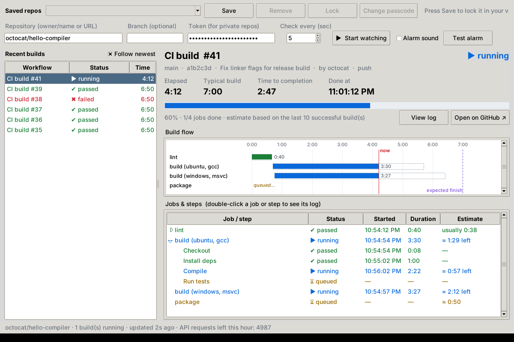

# GetHub WatchDog

**Watch your GitHub Actions builds live on your PC — and get an alarm the moment they finish.**

Works with any language and any compiler (gcc, clang, MSVC, javac, rustc, Go, .NET, Node…), because it watches GitHub's build service itself. Free and open source.

## Download (Windows)

**[⬇ Download GetHubWatchDog.exe](https://github.com/WhiteBoyStudios/GetHub-WatchDog/releases/latest/download/GetHubWatchDog.exe)** — one file, nothing to install, runs from a USB stick.
Or get the [zip with instructions](https://github.com/WhiteBoyStudios/GetHub-WatchDog/releases/latest/download/GetHubWatchDog-Portable.zip).

The first time you run it, Windows may say *"Windows protected your PC"* because the app isn't code-signed: click **More info → Run anyway**.

On Mac or Linux, use the Python version: download [`gethub_watchdog.py`](gethub_watchdog.py) and run `python3 gethub_watchdog.py` (needs Python 3.9+ with Tk).

## Quick start
1. Create a GitHub token at [github.com/settings/personal-access-tokens/new](https://github.com/settings/personal-access-tokens/new): pick your repository and set **Actions** to **Read-only**. (Public repos work without a token, but only update every 2 minutes.)
2. Open GetHub WatchDog, type the repository as `owner/name`, paste the token, press **Start watching**.
3. Press **Save** to keep it in your passcode-locked vault for next time.

## What it shows
- **Recent builds** for the repository, with pass / fail / running status
- **Elapsed time**, **typical build time**, **time to completion** and the **clock time it will be done**
- **Build flow** timeline: each job as a bar, with a dashed outline showing how long that job usually takes, a red "now" line and a purple "expected finish" line
- **Jobs & steps**: every step with its start time, duration and time left
- **Alarm**: when a build it saw running finishes, a pop-up appears on top of your other windows and a sound repeats (rising tones = passed, falling tones = failed) until you press **Stop alarm** (it stops by itself after 60 seconds)

**Compile failures vs. publish failures.** GitHub marks a whole run as failed if any job fails, even when the code compiled fine and only a release/publish job broke. WatchDog checks which jobs failed: if only publish-type work failed (a job or step whose name contains *release, publish, deploy, pages, upload, notify, announce* or *docker push*), it reports **✔ built · publish ✖** in orange, plays the success sound and says the code compiled. A real compile or test failure is still shown in red. You can change the word list under `"publish_keywords"` in the settings file.

**Failure logs.** Click **View log**, double-click any job or step, or press **Show failure log** on the alarm pop-up. WatchDog downloads that job's complete log from GitHub (for example the whole `release` job log) and:
- shades the step that failed and jumps to its first error
- lists every error line under *What went wrong* — click one to jump to it
- lets you switch to *Failed step only* or *Errors & warnings only*, search with **Find**, and **Save log…** to a file
The job list at the top lets you open the log of any other job in the same build. Logs need the token's **Actions: Read-only** permission, and GitHub only provides a job's log once that job has finished.

Time estimates come from the median of the last 10 successful builds of the same workflow, so they appear once a workflow has passed at least once.

## Two versions

| Version | Where | Needs |
|---|---|---|
| **Standalone (portable)** | [`portable/GetHubWatchDog.exe`](portable/) in this repository, or **GetHubWatchDog-Portable.zip** on the [Releases](../../releases/latest) page | Windows only — nothing to install |
| **Python** | [`gethub_watchdog.py`](gethub_watchdog.py) | Python 3.9+ (Windows, Mac or Linux) |

Both are the same app. The standalone version is rebuilt from `gethub_watchdog.py` and test-launched on Windows automatically every time the app changes, so the two always match.

## Portable version (no Python needed)
For a USB stick, a laptop while traveling, or a library PC: download `portable/GetHubWatchDog.exe` from this repository (or **GetHubWatchDog-Portable.zip** from the Releases page), put it anywhere (e.g. your USB stick) and double-click it. Nothing is installed and nothing is written to the PC — settings are kept in `GetHubWatchDog-settings.json` next to the .exe. If Windows says "Windows protected your PC", click **More info → Run anyway** (the app isn't code-signed).

## Saved repos and the passcode vault
Keep as many repositories as you like, each with its own token and branch, and switch between them from **Saved repos** at the top.
- Fill in a repository, branch and token, then press **Save**. The first time, you choose a passcode (at least 4 digits).
- Each time the app opens it asks for the passcode. **Lock** hides everything again; **Change passcode** sets a new one.
- Everything in the vault — tokens *and* repository names — is encrypted in the settings file. Tokens are never saved anywhere else.
- After **10 wrong passcodes in a row** the app erases the vault. **Forgot passcode…** also erases it so you can start over (your tokens still work on GitHub; paste them again).

**How safe is a 4-digit passcode?** It stops anyone who finds your stick and opens the app. Someone who copies the settings file and runs their own cracking program isn't limited to 10 tries, though: each guess is made deliberately slow (about a second and 128 MB of memory), but 4 digits is only 10,000 guesses, so a determined person could still get in within hours. For more protection use a longer passcode (6–8 digits or a few words) — and either way, use read-only tokens and delete them at github.com/settings/tokens if you lose the stick.

## Run it from Python
1. Install Python 3.9 or newer from https://python.org (on Windows, tick "Add Python to PATH"; tkinter is included).
2. Double-click `gethub_watchdog.py`, or run `python gethub_watchdog.py`.
3. Enter the repository as `owner/name` (or paste its GitHub URL) and press **Start watching**.

## Token (recommended)
Without a token GitHub allows only 60 requests an hour, so the app checks every 2 minutes. With a token it can check every few seconds.

Create one at GitHub → Settings → Developer settings → Personal access tokens → **Fine-grained token**, give it access to your repository with **Actions: Read-only** permission, and paste it into the Token box. For private repositories a token is required.

Tokens are only ever saved inside the passcode-locked vault. Other settings are saved in `~/.gethub_watchdog.json` when running from Python (or next to the .exe for the portable version).

## Make a Windows .exe (optional)
Double-click `build_windows_exe.bat`. It installs PyInstaller and produces `dist\GetHubWatchDog.exe`, which runs without opening a console window.

## Tips
- **Follow newest** keeps the view on the latest running build. Click any build in the list to pin it instead.
- **Test alarm** plays the sound so you can check your volume.
- **Branch** limits the list to one branch (leave blank for all).

## Privacy
GetHub WatchDog talks only to GitHub (`api.github.com`) using your own token. It has no servers, accounts, analytics or tracking. Your settings stay in one file on your own computer or USB stick.

## Contributing
Bug reports and ideas are welcome in [Issues](https://github.com/WhiteBoyStudios/GetHub-WatchDog/issues). Pull requests too: change `gethub_watchdog.py` and the Windows `.exe` rebuilds itself automatically.

## License
[MIT](LICENSE) — free to use, copy and modify.

GetHub WatchDog is an independent project and is not affiliated with or endorsed by GitHub, Inc.
